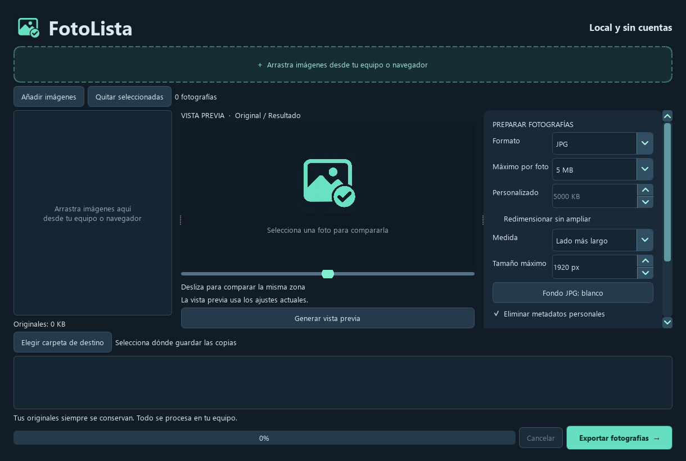

# FotoLista

Aplicación de escritorio para Windows que prepara fotografías por lotes: reduce su peso, redimensiona y convierte formatos conservando los originales.



## Para usar la aplicación

Descarga el instalador o el ZIP portable desde **Releases**, cuando haya una versión publicada. El paquete incluye lo necesario: no necesitas Python ni terminal. Extrae completo el portable y conserva `_internal` junto a `FotoLista.exe`.

La distribución 1.0.2 aún no tiene firma de editor: Windows puede mostrar advertencias. No se garantiza su ausencia. La distribución certificada mediante Microsoft Store está pendiente.

## Funciones

- Arrastrar imágenes desde carpetas o añadirlas mediante el selector.
- Máximo por fotografía: 500 KB, 1 MB, 2 MB, 5 MB o personalizado.
- Redimensionar por ancho o lado largo, conservando proporciones y sin ampliar.
- Salida JPG, PNG y WebP; lectura HEIC/HEIF compatible.
- Fondo para transparencia al convertir a JPG; eliminación de metadatos personales.
- Comparación antes/después, renombrado con prefijo y numeración.
- Exportación segura sin sobrescritura, progreso, cancelación y continuidad tras errores.

El procesamiento de archivos locales funciona sin internet. Importar una imagen mediante un enlace web requiere conexión y puede estar limitado por el sitio de origen. Las imágenes animadas y de varias páginas no se admiten.

## Desarrollo en Windows

Usa Python 3.12 de 64 bits. Desde PowerShell, en esta carpeta:

```powershell
python -m venv .venv
.\.venv\Scripts\python.exe -m pip install --dry-run --only-binary=:all: -r requirements.txt
.\.venv\Scripts\python.exe -m pip install --only-binary=:all: -r requirements.txt
.\.venv\Scripts\python.exe main.py
```

También puedes usar `configurar.ps1`. Selecciona el entorno `.venv` en VS Code. Abre la app sin permisos de administrador para permitir el arrastre desde el Explorador normal.

## Pruebas

```powershell
.\.venv\Scripts\python.exe -m unittest discover -s tests -v
```

23 pruebas cubren límites de bytes, orientación, transparencia, originales intactos, nombres duplicados, inválidos, HEIC, cancelación, importación y el flujo de interfaz. Se validó el ejecutable con PATH sin Python, además de instalación y desinstalación aisladas. Falta probar accesos directos y registro de desinstalación en un Windows limpio.

## Empaquetado

```powershell
.\empaquetar.ps1
```

Genera `dist/FotoLista/FotoLista.exe`. Distribuye toda esa carpeta. Para crear el instalador, instala Inno Setup desde su sitio oficial y ejecuta:

```powershell
.\crear-instalador.ps1 -ISCC "C:\Program Files (x86)\Inno Setup 6\ISCC.exe"
```

El instalador incluye acceso en Inicio, escritorio opcional y desinstalación por usuario. Los archivos compilados se publican como adjuntos de una Release, sin incorporarlos al historial del código.

## Estructura

`fotolista/ui.py` contiene la interfaz; `processing.py`, el motor; `exporting.py`, la escritura segura; `workers.py`, el procesamiento en segundo plano; `dropdata.py` e `importing.py`, la recepción de imágenes.

Consulta `CONTEXTO_PROYECTO.md` para retomar el desarrollo y `TERCEROS.md` para las dependencias y sus licencias. La visibilidad pública del repositorio no concede por sí sola una licencia de reutilización del código propio de FotoLista; esa licencia está pendiente de definir por el autor.
